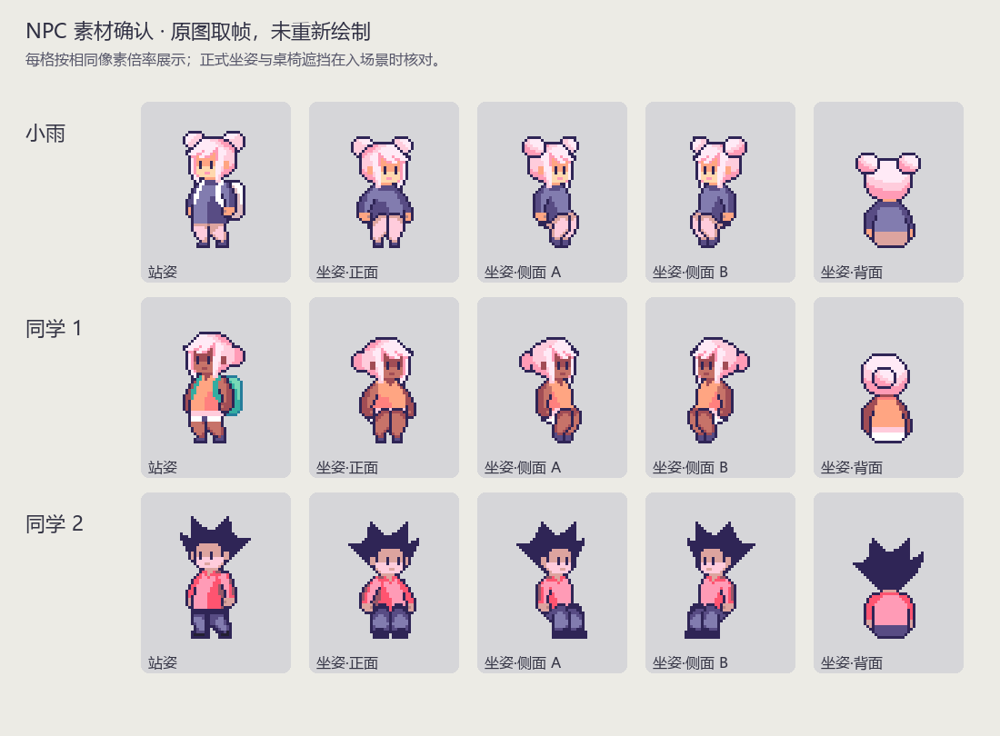
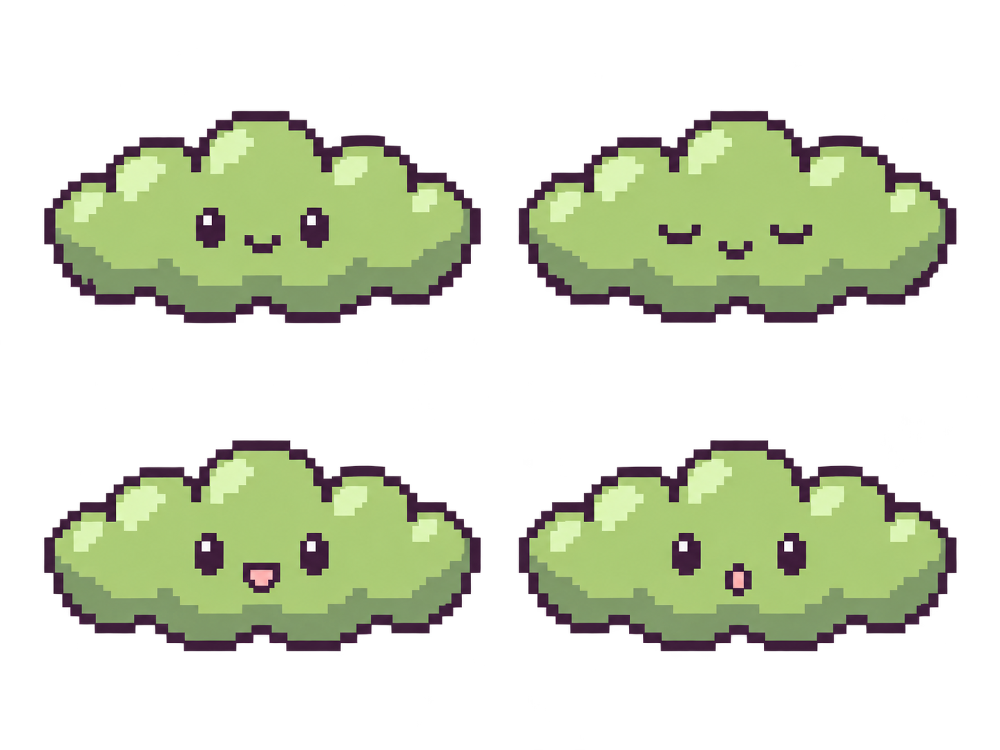
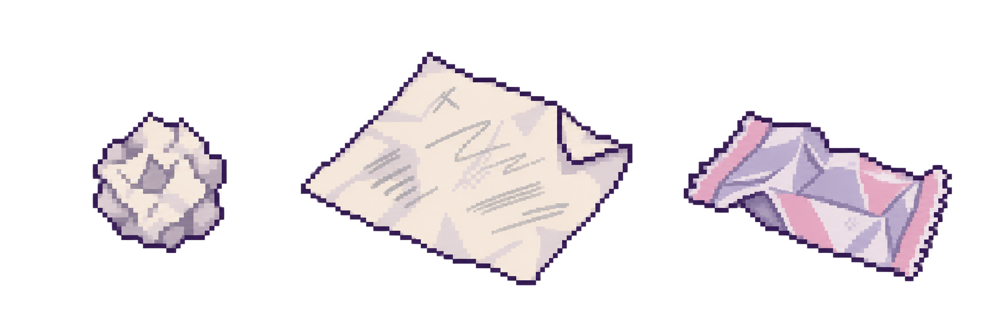
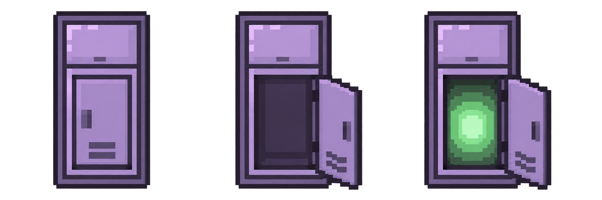

# 第一章第二步：素材与形象预览

日期：2026-10-24。

状态：第一步的位置与核心规则已确认，用户已授权进入第二步。本轮完成素材取帧和视觉提案；新增形象与坐姿建议待用户审阅，不代表已获准进入场景制作。

所有输出位于 `Docs/Design/Step02-Previews`，没有修改 `Assets`、场景、角色原图或 Unity 的 Sprite Editor 切片。

## 1. NPC：沿用已选身份，使用原图现成坐姿

来源为 `Assets/角色/cozy_cafe_characters.png`。已按用户指定的三组人物分别截取站姿、正面坐姿、右侧坐姿、左侧坐姿、背面坐姿，共 15 个预览帧，没有重新绘制人物或改色。

| 人物 | 已确认身份 | 建议用于场景的姿态 | 原因 |
| --- | --- | --- | --- |
| 小雨 | 粉色双丸子头、深蓝衣服 | 朝上坐，使用背面坐姿 | 对应左教室上排最左课桌，椅子在桌子下方 |
| 同学 1 | 浅粉头发、橙衣、绿色背包 | 朝右坐，预览中的侧面 A | 对应右教室下排左侧朝右的桌椅 |
| 同学 2 | 深紫色尖发、红色上衣 | 朝上坐，使用背面坐姿 | 对应左教室下排最右课桌，椅子在桌子下方 |

原图坐姿和站姿的服装、背包可见程度不同，预览保留源素材，不额外补画。人物身份已确认，具体坐姿是本轮建议。后续入场景时按椅面和桌缘调整人物脚底/坐姿锚点，不为适配角色移动现有桌椅。先不新增巡逻或行走行为。

每个预览帧使用 32×64 透明画布保存原始像素，人物底部对齐仅供比较。`npc-source-rects.json` 记录原图左上坐标系的取帧范围及原图 SHA-256。预览画布和对齐方式不是最终 Unity 导入设置。

## 2. 抹茶云：绿色小云提案，待确认

建议采用横向圆润云团、抹茶绿主体、浅绿色高光、深紫色描边；不添加服装、四肢或额外饰品。

- 左上：默认表情。
- 右上：闭眼，用于初遇时尚未回应的状态。
- 左下：说话表情。
- 右下：惊讶表情。

四格用于确认同一角色的表情，不是可以直接播放的逐帧动画。柜内、柜台与跟随女主时沿用同一身份，显示尺寸与漂浮动作在后续制作时处理。NPC 头上的灰云是另外的云视表现，不与抹茶云本人混为同一素材。

## 3. 清扫物品：三种外形提案，待确认

从左到右：纸团、废弃画纸、空包装纸。建议米白纸张搭配灰紫折痕，包装纸使用浅紫粉色，与学校现有色板协调。

- 普通清扫点使用纸团/包装纸等可清理物品；每点数量未在本步骤决定。
- 再生点复用纸团或废弃画纸的普通外观。异常调查阶段交互直接显示“无法清理”，不因为外观相同就误走普通拾取逻辑。
- 绿色线索仅作为之后的云视叠加提案；普通视野下不持续发绿光，以保留发现异常的过程。
- 小雨的画本、正在创作的画纸和保留的草稿是独立剧情物品，不因同样是纸张就被归入垃圾。
- 右下角书本继续使用现有 `Scattered_Books`，执行已确认的“整理书本 → 该组书本消失”，无需用本轮垃圾图替换。

## 4. 柜门：保留原柜外观，补充开启状态提案

从左到右：关闭、普通开启、入口开启后呈现绿色光。以 `locker-closed-reference.png` 中现有 32×64 柜子作为正式外观依据，生成提案不是对原柜的逐像素替代。

建议仅让下方主柜门开启，上方柜格保留；初遇柜开启后显示抹茶云相关内容，入口柜在剧情条件达成后显示绿光。开启后的门扇占位必须在下一步交互制作时检查，不能遮住邻柜或阻塞走廊。

本轮没有接入开关门、碰撞状态、场景传送或光效。

## 5. 资源完成度与后续条件

| 类别 | 本轮已完成 | 尚需完成 |
| --- | --- | --- |
| NPC | 已确认身份的原图取帧与坐姿预览 | 用户确认姿态；后续切片、场景摆放与遮挡验证 |
| 抹茶云 | 形象和四种表情概念图 | 用户确认外形/配色；正式小尺寸像素素材、必要动画 |
| 垃圾 | 三种物品外形概念图 | 用户确认；统一实际像素尺寸、落地透视与轮廓 |
| 柜门 | 原柜参考与三种状态概念图 | 用户确认；基于原柜补齐准确的开门素材和交互 |

生成图片是放大视觉提案，尚未统一到源素材严格的像素网格和有限色板，也不是已经验证可直接使用的游戏 Sprite。用户通过设计后，再完成像素尺寸、透明边缘、对齐和实际游戏缩放检查。建议目标范围：抹茶云约 32×24 像素，纸团约 16×16，废纸与包装纸约 24×20；这些尺寸是制作起点，不是已经批准的规格。

生成方式：内置 `image_gen`。最终采用的提案及全部提示词保存在本目录的 `Step02-Previews/generation-prompts.md`。NPC 和关闭柜参考为现有素材的直接取帧，未由生成模型重新绘制。

第二步验收重点：三位 NPC 坐姿是否认可；抹茶云形状与配色是否认可；垃圾种类和辨识度是否认可；柜门开启方向与绿光是否认可。审阅通过后再进入正式素材准备与第三步交互实现，不自动执行下一阶段。
