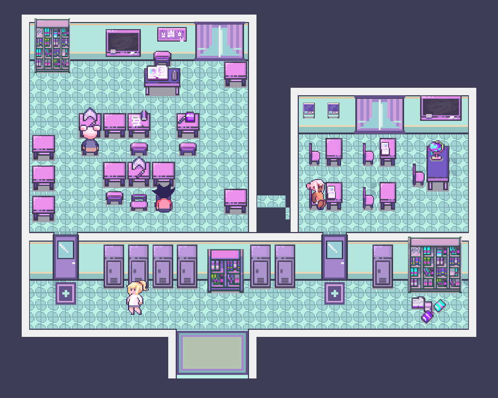
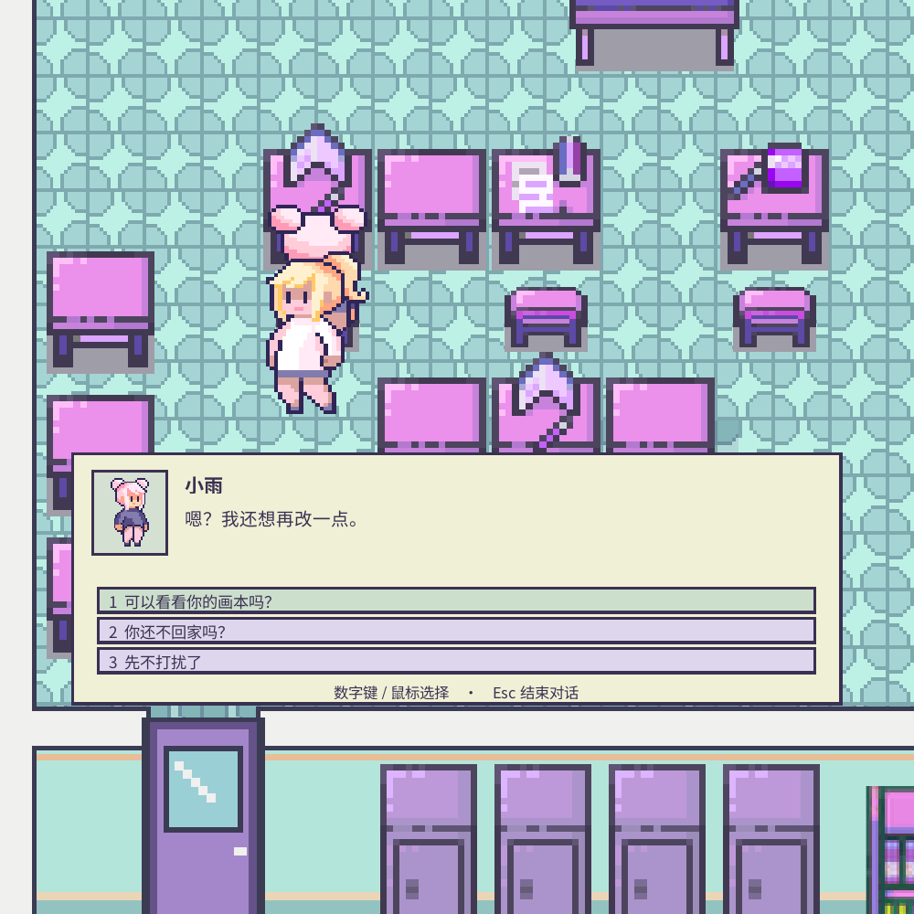

# 第一章：第三、四步交互实现

日期：2026-10-24。场景：`Assets/Scenes/school.unity`。

## 已实现的内容

- 靠近目标出现 E 提示；E、点击提示或点击附近目标可交互。距离过远、隔着墙体时无法触发。
- 指定的初遇柜 `Locker_5.5` 和入口柜 `Locker_14.5` 可分别开关。上部柜格不动；下部门扇采用现有像素素材的独立切片，开启图形收在本柜宽度内。其余柜子不增加交互。
- 小雨、同学 1、同学 2 固定坐在已确认的三个座位，沿用原角色素材；各有独立的基础对话、脚部碰撞与 Y 轴遮挡排序。
- 小雨的画本位于上排最左课桌。未经同意时提示先询问；和小雨对话，明确选择“可以看看你的画本吗？”后才可以翻看。支持两页文字描述、前后翻页和合上。
- 右教室指定墙面通知可阅读。对话期间暂停移动，关闭或取消后恢复。
- 简体中文字体随项目导入，不依赖玩家电脑安装字体。
- 日常对话与调查阶段分开。单独获得画本许可不会提前开启调查内容；日常翻看只展示普通线稿描述。NPC 预留 `CloudViewAnchor` 空节点供后续云视表现使用，目前不显示灰云或线索特效。

## 试玩

1. 打开学校场景，按 Play。沿用方向键或 WASD 移动。
2. 走近左侧四个柜子中的第三个，按 E 开关；右侧大书柜左边的指定柜子同样可开关。
3. 前往左教室上排最左座位，靠近小雨按 E。数字键 1/2/3 或鼠标选择，Esc 结束。
4. 尚未征得同意时，靠近小雨课桌右前侧查看画本，会提示先询问。获得许可后再次查看即可翻页。
5. 同学 1 在右教室下排左侧座位；同学 2 在左教室下排最右座位。右教室左上第一张小通知可阅读。

## 场景保护与素材

没有重建场景、替换地板或移动家具。原有 Transform、SpriteRenderer、Tilemap、颜色及图层数据在安装前后做了比较；原有角色控制和摄像机脚本保持原样。MochaStore 未修改；train 的原有未提交修改保留。

备份：`Recovery/School/school-before-interactions-20261024-105717.unity`。

NPC 通过 Unity Sprite Editor 的数据接口在原图中追加 15 个子 Sprite，保留已有切片名称、矩形和 ID。原 PNG 的 SHA-256 仍为 `0d88c7f0788a799eb5cb3ce11073df0ace9752b4f6d4242da9c56b562c71a9e0`。

场景 NPC 使用 `SchoolNPC_Xiaoyu_Back`、`SchoolNPC_Classmate01_SideA`、`SchoolNPC_Classmate02_Back`；对话小像使用对应正面坐姿。三个 Prefab 位于 `Assets/Prefabs/School`。

中文字体使用未经修改的 [Noto Sans SC](https://github.com/notofonts/noto-cjk)，SIL Open Font License 1.1 原文随字体保存在 `Assets/Fonts/NotoSansSC/LICENSE.txt`。

## 实现入口

| 文件 / 对象 | 用途 |
| --- | --- |
| `School_ReferenceLayout/07_Interactions` | 三位 NPC 与学校交互控制器 |
| `Assets/Scripts/School/SchoolInteractionController.cs` | 邻近检测、隔墙判断、中文对话、许可和翻页、移动暂停 |
| `Assets/Scripts/School/SchoolInteractable.cs` | 稳定 ID、交互类型、接近锚点与距离 |
| `Assets/Scripts/School/SchoolLocker.cs` | 柜门状态、开关图形、重复输入防抖 |
| `Assets/Editor/SchoolInteractionSetup.cs` | 有备份与保护检查的安装工具；已安装后拒绝重复执行 |
| `Assets/Editor/SchoolInteractionChecks.cs` | 原生 Play 模式交互验收 |

可在 `Tools > School > Verify Interactions and NPCs` 运行交互测试。原有移动与摄像机测试入口是 `Verify Character and Camera`。测试会临时移动运行中的女主，结束后退出 Play，不把测试位置写入场景。

交互测试按游戏实际帧的计时推进；如果 Unity 最小化后暂停游戏帧，请恢复窗口，测试会继续。这样不会将编辑器后台计时误当成柜门防抖时间已经过去。

## 本轮验证

Unity 实际编译与 Play 模式验证通过：七个目标 ID 唯一、中文字体可用、无缺失脚本；远距离与隔墙交互拒绝；两柜独立开关与防抖；许可前禁止翻看、取消不授予许可、其他同学不改变许可；翻页与关闭正常；对话关闭及组件停用正确恢复原移动状态；三位 NPC 的脚部碰撞、角色前后排序正确。交互测试期间未记录运行时错误或异常。

实际 Game 视图手动检查通过：E 打开小雨对话，数字键 1 获得许可，鼠标点击“继续”关闭，再次 E 交谈显示已许可文案，Esc 退出，D 键恢复向右移动与对应朝向。

原有移动、斜向速度、动画、家具碰撞、门口通行、窗帘与地毯图层检查通过。摄像机在方形、16:9、竖屏、超宽四种比例下经过教室、门口、走廊与入口的边界检查通过。

另与修改前的原生场景备份逐项比较：370 个原有 Transform（允许新增子对象）、189 个 SpriteRenderer、86 个 BoxCollider2D、56 个 Tilemap、56 个 TilemapRenderer、3 个 Camera 均未发生配置变化。记录位于 `Recovery/School/interaction-preservation-check.json`；运行测试记录为同目录的 `interaction-tests.txt` 与 `interaction-camera-regression.txt`。

预览图：

## 当前阶段边界

本轮是柜门与 NPC 交互基础。两扇柜门暂时只开关，尚不触发抹茶云出现、绿光或场景传送。画本暂以文字描述呈现两页；对白为符合当前人物设定的基础文案，完整剧情分支和画本插图留待主线制作。

许可只保存在本次学校场景运行中，重新加载场景或重新开始 Play 会重置；后续与章节存档统一连接。此处没有发放“微涩的抹茶粉”，也没有提前完成任务。

第五步的清扫、再生点、“无法清理”、柜中奇遇，以及“整理这些书本”后书本消失与跨场景保留状态，尚未实施。
